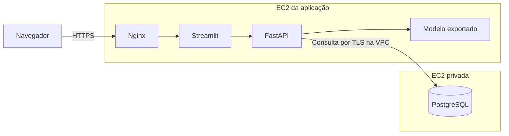

# Previsão de churn com MLOps

Projeto de classificação que estima a probabilidade de um cliente cancelar o
serviço. O fluxo cobre validação de dados, treinamento, seleção de modelo no
MLflow e inferência online com FastAPI e Streamlit.

**[Abrir a demonstração pública](https://3.148.175.181/)**

Busque pelo código `1069-XAIEM` ou `0902-XKXPN` e clique em **Buscar e prever**.

[Arquitetura](#arquitetura) · [Executar localmente](#executar-localmente) ·
[Treinamento e MLflow](#treinamento-e-mlflow) · [API](#api) ·
[Deploy na AWS](#deploy-na-aws) · [Testes](#testes)

## Arquitetura



Na AWS, Streamlit e FastAPI rodam em dois contêineres da **mesma imagem
Docker**. O Nginx publica a interface, e o FastAPI busca os dados do cliente
no PostgreSQL com uma conta de leitura. O modelo exportado é carregado no
início do processo e usado a cada previsão.

O Compose local monta o CSV no frontend para a busca por código. O overlay
`compose.postgres.yaml` ativa a busca pela API e remove a montagem do CSV.

## Executar localmente

Use Python 3.12, Git e Docker com Compose v2. Abra o PowerShell para clonar
o projeto e executar os comandos.

### 1. Preparar o ambiente e o dataset

```powershell
git clone https://github.com/JoelFarias/Mlops.git
cd Mlops

py -3.12 -m venv .venv
$churnPython = ".\.venv\Scripts\python.exe"
& $churnPython -m pip install -r requirements.txt
$env:PYTHONPATH = "src"
```

Em um clone novo, baixe o CSV com 7.043 registros para `data/raw/churn.csv`.
[Dataset Telco Customer Churn da IBM](https://github.com/IBM/telco-customer-churn-on-icp4d/blob/d5371f5d83a446ad5673cbcca3b814b926491f8a/data/Telco-Customer-Churn.csv)

```powershell
New-Item -ItemType Directory -Path data/raw -Force | Out-Null
$churnDataset = "https://raw.githubusercontent.com/IBM/telco-customer-churn-on-icp4d/d5371f5d83a446ad5673cbcca3b814b926491f8a/data/Telco-Customer-Churn.csv"
Invoke-WebRequest -Uri $churnDataset -OutFile data/raw/churn.csv
```

### 2. Treinar, exportar e iniciar a aplicação

```powershell
& $churnPython -m churn.experimentos
& $churnPython -m churn.exportar
docker compose build backend
docker compose up -d --no-build --pull never --wait --wait-timeout 180
```

Consulte um cliente no Streamlit ou teste as rotas no Swagger.
[Streamlit local](http://127.0.0.1:8501/) · [Swagger local](http://127.0.0.1:8000/docs)

Verifique a prontidão do modelo e execute uma previsão de teste.

```powershell
docker compose exec -T backend python scripts/verificar-deploy.py
```

Use `docker compose down` para parar os contêineres. Caso as portas locais
estejam ocupadas, defina `CHURN_PORTA_API` e `CHURN_PORTA_FRONTEND` antes de
subir o Compose.

<details>
<summary>Executar a API e o Streamlit sem Docker</summary>

Depois do treinamento, rode a API na raiz do projeto.

```powershell
$env:PYTHONPATH = "src"
.\.venv\Scripts\python.exe -m uvicorn churn.api.aplicacao:app --reload
```

Em outro terminal, inicie o Streamlit.

```powershell
$env:PYTHONPATH = "src"
.\.venv\Scripts\python.exe -m streamlit run src/churn/frontend/app.py
```

Na barra lateral, escolha o modelo local do MLflow ou a API FastAPI. O modo
API usa `http://127.0.0.1:8000` por padrão.

</details>

## Treinamento e MLflow

1. **Validar e dividir os dados.** O Pandera verifica o contrato do CSV. A
   divisão estratificada usa 60% dos registros para treino, 20% para validação
   e 20% para teste, com seed 42.
2. **Comparar configurações.** A busca testa nove combinações de Random Forest,
   com 100, 200 ou 500 árvores e profundidade livre, 8 ou 16. A maior ROC AUC
   na validação seleciona o vencedor da busca.
3. **Avaliar e registrar.** O vencedor é avaliado no conjunto de teste. Se
   `test_roc_auc >= 0.80`, o MLflow registra a versão em `churn` e atribui o
   alias `champion`. O relatório da seleção fica em `selecao.json` no run
   principal.
4. **Exportar.** `churn.exportar` fixa a versão do alias em `artifacts/modelo`.
   O pacote inclui o pipeline de pré-processamento e o modelo usado na imagem
   da aplicação. Para exportar outra versão, indique uma pasta nova com
   `--destino`.

O experimento que registrou `churn/1` obteve ROC AUC de **0,8425** no teste.
O MLflow usa `mlflow.db` para Tracking e Registry. Os runs registram os
parâmetros, as métricas, o hash do CSV e o commit Git. Abra a interface e
selecione o experimento `churn-tuning`.

```powershell
.\.venv\Scripts\mlflow.exe ui --backend-store-uri sqlite:///mlflow.db
```

[Interface local do MLflow](http://127.0.0.1:5000/) · [Guia de MLflow](mlflow_guia.md)

## API

`POST /prever` recebe os 19 atributos do cliente e devolve a classe `churn`,
a `probabilidade` e o `limiar` de decisão. O limiar padrão de inferência é
0,50 e pode ser definido por `LIMIAR_CHURN`. [Contrato interativo no Swagger](http://127.0.0.1:8000/docs)

| Método e rota | Função |
| --- | --- |
| `GET /` | Formulário local para enviar os atributos de um cliente |
| `GET /saude` | Estado do processo e do modelo |
| `GET /pronto` | Retorna 200 quando o modelo está carregado |
| `GET /modelo` | Origem, versão e alias do modelo em uso |
| `GET /clientes?codigo=1069-XAIEM` | Consulta por código com PostgreSQL configurado |
| `POST /prever` | Calcula a probabilidade de churn |
| `POST /modelo/recarregar` | Recarrega o modelo quando a operação está habilitada |

## Deploy na AWS

O deploy usa duas instâncias Ubuntu na mesma VPC. A primeira recebe o pacote
da aplicação com `scripts/deploy-ec2.ps1 -Publico -Postgres`. A segunda carrega
a imagem do PostgreSQL com `scripts/iniciar-postgres-ec2.sh`. O banco usa
IPv4 privado, e o certificado público do Nginx tem renovação automática.
[Guia de configuração das duas EC2](docs/deploy-ec2.md#postgresql-em-uma-segunda-ec2)

### Imagem do PostgreSQL

O `Dockerfile.postgres` inclui o CSV e o importa para `public.clientes` no
banco `churn` quando o volume é inicializado pela primeira vez. O campo
`"customerID"` é a chave primária.

```powershell
docker build --platform linux/amd64 -f Dockerfile.postgres -t churn-postgres:1.0 .
New-Item -ItemType Directory -Path artifacts -Force | Out-Null
docker save -o artifacts/postgres-churn.tar churn-postgres:1.0
```

Em outro host Docker, carregue a imagem com
`docker load -i artifacts/postgres-churn.tar`. O volume
`churn-postgres-dados` preserva os registros entre recriações do contêiner.

<details>
<summary>Conferir a importação local do CSV</summary>

```powershell
$env:POSTGRES_PASSWORD = [guid]::NewGuid().ToString("N")
docker run -d --name churn-postgres --env POSTGRES_PASSWORD `
  --mount type=volume,source=churn-postgres-dados,target=/var/lib/postgresql/data `
  churn-postgres:1.0
Remove-Item Env:POSTGRES_PASSWORD
```

Quando o PostgreSQL estiver pronto, confira a contagem de clientes.

```powershell
docker exec churn-postgres psql -U postgres -d churn -c 'SELECT count(*) FROM public.clientes;'
```

</details>

## Testes

```powershell
.\.venv\Scripts\python.exe -m pytest -q
```

Os testes cobrem contrato dos dados, engenharia de atributos, seleção do modelo,
API e frontend. O teste de schema com `lazy=True` reúne as violações de uma
amostra inválida antes do treinamento. [Testes do contrato](tests/teste_dados.py)

## Estrutura do projeto

| Caminho | Conteúdo |
| --- | --- |
| [src/churn/](src/churn/) | Validação, treinamento, avaliação e exportação |
| [src/churn/api/](src/churn/api/) | API de inferência e consulta ao PostgreSQL |
| [src/churn/frontend/](src/churn/frontend/) | Interface de consulta em Streamlit |
| [deploy/](deploy/) | Configuração do Nginx, renovação TLS e SQL do PostgreSQL |
| [scripts/](scripts/) | Empacotamento, deploy e verificação |
| [docs/](docs/) | Guia de operação na EC2 |
| [tests/](tests/) | Testes automatizados |
| [train_churn.py](train_churn.py) | Script inicial do projeto |

## Licença

[MIT](LICENSE).
