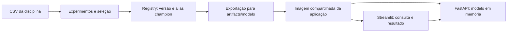
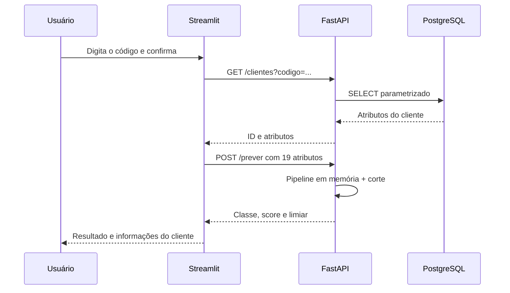

# Guia técnico do projeto de churn

Este guia descreve o fluxo mantido: base da disciplina → treinamento e seleção
→ exportação de uma versão → FastAPI e Streamlit. Os caminhos são relativos
à raiz do repositório. O manual de operação está em
[docs/deploy-ec2.md](https://github.com/JoelFarias/Mlops/blob/main/docs/deploy-ec2.md).

## 1. O que o projeto faz

Churn significa cancelamento de clientes. O modelo aprende com exemplos
rotulados e estima o risco de cancelamento a partir de 19 atributos. Essa
estimativa pode apoiar a priorização de análise ou ações de retenção; não
demonstra, por si só, o efeito de uma campanha.

Há dois momentos diferentes:

| Momento | Entrada | O que acontece | Saída |
| --- | --- | --- | --- |
| Treinamento | CSV com atributos e `Churn` conhecido | Valida, treina nove configurações e avalia a escolhida | Uma versão identificada do pipeline |
| Inferência | Atributos de um cliente | Usa o pipeline já treinado e aplica um corte ao score | Classe, probabilidade estimada e limiar |

`customerID` localiza o cliente, mas não entra no modelo. `Churn` é o alvo que
queremos prever e também não entra como atributo.



## 2. Dados e resultados da disciplina

A base original do professor está em `data/raw/churn.csv` e acompanha o clone
e o Download ZIP. Não existe etapa de download de outro dataset.

- 7.043 clientes e 21 colunas: identificador + 19 atributos + alvo.
- 2.291 cancelaram e 4.752 permaneceram.
- 11 registros têm `TotalCharges` vazio; nesses registros, `tenure` é zero.
- MD5: `d390bd07b5514a2256a2396993b8b0e3`.
- SHA-256: `1b90d77671ab4d396b1bd403eadd764d8457aec50467ad99f586eaabf9304596`.

O hash identifica os bytes da base utilizada. Não é criptografia do arquivo,
não faz backup e não substitui a preservação dos dados.

| Resultado reproduzido | Valor |
| --- | --- |
| Configuração selecionada | Random Forest, 500 árvores, profundidade máxima 8 |
| ROC AUC na validação | 0,8216 |
| ROC AUC no teste | 0,8269 |
| Acurácia no teste | 77,22% (1.088 acertos de 1.409) |
| Recall de churn no teste | 59,83% (274 dos 458 cancelamentos encontrados) |
| Precisão dos alertas | 66,67% (274 dos 411 alertas eram cancelamentos) |
| F1 no teste | 0,6306 |

A acurácia inclui quem cancelou e quem permaneceu. Prever sempre “não cancela”
já acertaria 67,49% desse teste, mas não encontraria cancelamento algum.

A ROC AUC mede a ordenação do risco: o modelo tende a colocar clientes que
cancelaram acima dos que permaneceram. Não é a fração de classificações
corretas nem a probabilidade de cancelamento de um cliente específico.

O recall responde à pergunta do negócio mais diretamente: dos 458 clientes
que cancelaram, 274 receberam alerta e **184 passaram sem identificação** no
corte padrão. Houve também 137 falsos alarmes.

| Realidade / previsão | Prevê que permanece | Prevê churn |
| --- | --- | --- |
| Permaneceu | 814 | 137 |
| Cancelou | 184 | 274 |

Esses números avaliam uma partição fixa da base da disciplina. Não comprovam
desempenho futuro, calibração das probabilidades, equidade ou ganho financeiro.

## 3. Treinamento, registro e exportação

### Os arquivos principais

| Arquivo | Responsabilidade |
| --- | --- |
| `src/churn/dados.py` | Leitura do CSV e validação do contrato de treino |
| `src/churn/schema.py` | Regras Pandera para as colunas verificadas |
| `src/churn/pipeline.py` | Feature, imputação, codificação e Random Forest |
| `src/churn/experimentos.py` | Busca, seleção, avaliação, registro e promoção |
| `src/churn/mlflow.py` | Consulta ao Git para registrar o commit do código |
| `src/churn/exportar.py` | Exportação de uma versão numérica para a aplicação |

### Passo a passo de `run_grid`

1. **Carrega o CSV.** `carregar_dados` interpreta espaços em branco como
   ausentes. `limpar_dados` prepara uma cópia e chama Pandera com `lazy=True`,
   reunindo violações em uma exceção. No fluxo de experimentos, o retorno dessa
   função serve para validar; o pipeline é responsável pela transformação real.
2. **Separa entrada e alvo.** Remove `customerID` e `Churn` de `x`. Converte
   `No` para 0 e `Yes` para 1 em `y`.
3. **Divide os dados.** Reserva 20% para teste; usa 25% dos 80% restantes para
   validação. São 4.225 registros de treino, 1.409 de validação e 1.409 de
   teste. A divisão é estratificada e usa `random_state=42`.
4. **Treina nove configurações.** Combina 100, 200 ou 500 árvores com
   profundidade livre, 8 ou 16. O pipeline ajusta imputadores e codificador
   apenas no treino.
5. **Escolhe na validação.** A maior `validation_roc_auc` vence. Em empate,
   conserva a primeira configuração na ordem do `ParameterGrid`.
6. **Mede no teste reservado.** Só o vencedor recebe métricas de teste. A
   implementação não retreina o vencedor juntando treino e validação.
7. **Aplica o mínimo de qualidade.** Se `test_roc_auc >= 0.80`, cria uma versão
   de `churn` e move `champion` para ela. Se reprovar, mantém o alias anterior.
   O critério não compara automaticamente com um champion já existente.

### O que há dentro do pipeline

A floresta recebe os dados após estas transformações:

- `TotalCharges` é convertido para número; ausência ou texto inválido vira 2.200.
- `gasto_por_mes = TotalCharges / (tenure + 1)` é criado; o `+1` evita dividir
  por zero. O campo derivado não é exigido na entrada HTTP.
- Categóricas recebem moda e one-hot. `handle_unknown="ignore"` permite
  transformar categorias que o codificador não viu no ajuste.
- Numéricas recebem imputação pela mediana.
- A Random Forest usa os parâmetros do grid, semente 42 e `n_jobs=-1`.

O pipeline salvo carrega o pré-processamento com o modelo. Não é preciso
reproduzir essas transformações manualmente no servidor.

### Tracking e Registry

O experimento padrão é `churn-tuning`. Uma busca padrão cria um run pai
`rf-tuning` e nove filhos. Cada filho guarda hiperparâmetros, métricas de
validação e um pipeline. O vencedor recebe as métricas de teste.

`data_sha256` e `git_commit` são tags de linhagem. `selecao.json`, no run pai,
registra o vencedor e a decisão de promoção. Os metadados e o Registry usam
SQLite por padrão; os arquivos dos modelos ficam no armazenamento de artefatos.

- `churn` é o nome registrado.
- Uma versão numérica identifica um modelo registrado.
- `champion` é um alias que pode apontar para outra versão.
- `models:/churn@champion` segue o alias; `models:/churn/1` fixa a versão 1.

### Exportação para servir

`churn.exportar` resolve o alias, baixa a versão numérica e verifica se ela
implementa `predict_proba` e contém a classe 1. Copia o pacote para
`artifacts/modelo` e adiciona `deploy.json` com nome, versão, alias, origem e
`run_id`. Recusa sobrescrever uma pasta que já exista.

O Docker inclui esse pacote. Assim, a API não depende de acessar o SQLite ou
o Registry do computador onde o treinamento foi feito.

**Dois limiares distintos:** 0,80 é o ROC AUC mínimo para registrar o modelo;
0,50 é o corte padrão do score individual para sinalizar um cliente.

## 4. Caminho de uma consulta na aplicação



O diagrama mostra a busca com PostgreSQL. No Compose local, a interface
busca o cliente diretamente no CSV montado para leitura e só chama a API na
etapa de previsão.

### Contrato de entrada

| Grupo | Campos |
| --- | --- |
| Perfil | `gender`, `SeniorCitizen`, `Partner`, `Dependents` |
| Tempo, contrato e cobrança | `tenure`, `Contract`, `PaperlessBilling`, `PaymentMethod`, `MonthlyCharges`, `TotalCharges` |
| Telefonia | `PhoneService`, `MultipleLines` |
| Internet e adicionais | `InternetService`, `OnlineSecurity`, `OnlineBackup`, `DeviceProtection`, `TechSupport`, `StreamingTV`, `StreamingMovies` |

O Pydantic exige esses 19 campos, aplica faixas/categorias e rejeita campos
extras. `customerID` é usado na busca, mas não vai em `POST /prever`.
A API encontra a coluna da classe 1 usando `classes_` e retorna `Yes` quando
o score é maior ou igual ao limiar.

```json
{"churn": "Yes", "probabilidade": 0.60, "limiar": 0.50}
```

Isso significa que o score foi 60% e ultrapassou o corte de 50%. Não é uma
acurácia de 60% nem uma garantia de cancelamento.

### Rotas

| Método e rota | Função |
| --- | --- |
| `GET /` | Formulário HTML para preencher atributos manualmente |
| `GET /docs` | Documentação OpenAPI/Swagger da API local |
| `GET /saude` ou `GET /health` | Processo responde; o modelo pode estar ausente |
| `GET /pronto` | 200 com modelo carregado; 503 sem modelo |
| `GET /modelo` | Nome, versão, alias, origem e limiar do serviço carregado |
| `GET /clientes?codigo=8888-XEBO` | Busca no PostgreSQL; 200 com objeto ou `null`, 503 se indisponível |
| `POST /prever` | Valida entrada e calcula o score; entrada inválida causa 422 |
| `POST /modelo/recarregar` | Tenta carregar de novo; preserva o anterior se falhar; 403 quando desabilitado |

O modelo é carregado na inicialização. As rotas síncronas executam o trabalho
bloqueante da previsão no threadpool do FastAPI. A API pode responder a
`/saude` mesmo sem ter modelo; por isso o Compose usa `/pronto`.

### Streamlit

`frontend/app.py` controla tela, chamadas HTTP, estado da consulta e exibição.
`frontend/dados.py` busca e normaliza códigos, prepara o JSON e traduz os
valores apenas para a tela. `frontend/inferencia.py` atende ao modo local em
que o próprio Streamlit carrega o modelo.

Na consulta pública, o modo é fixado em API; o visitante não escolhe a URL nem
vê botões de recarga. A predição é calculada no clique. O banco não treina o
modelo e a consulta não grava uma nova previsão.

## 5. Imagem da aplicação e modos de execução

| Arquivo | Papel |
| --- | --- |
| `Dockerfile.api` | Receita da imagem com Python, código, modelo exportado e dependências de execução |
| `compose.yaml` | Dois serviços com a mesma imagem: backend e frontend |
| `compose.publico.yaml` | Ajustes do perfil público e limites de recursos |
| `compose.postgres.yaml` | Conexão ao banco e remoção do bind de CSV no frontend |
| `Dockerfile.postgres` | Imagem do PostgreSQL que inclui o CSV e o SQL de carga |
| `Dockerfile.postgres.dockerignore` | Lista de inclusão específica para o build do banco |

**Imagem** é o pacote com o ambiente e os arquivos. **Contêiner** é uma
execução da imagem. Backend e frontend usam a mesma imagem, mas iniciam
processos diferentes: Uvicorn/FastAPI e Streamlit.

No Compose, `backend:8000` é o endereço interno usado pelo Streamlit. As
portas 8000 e 8501 do host ficam ligadas a `127.0.0.1`. O perfil público
é acessado pelo Nginx em HTTPS.

| Configuração | Fonte dos clientes | Inferência |
| --- | --- | --- |
| Compose base | CSV montado no frontend para leitura | FastAPI |
| Base + público | CSV montado no frontend | FastAPI, com interface pública restrita |
| Base + público + PostgreSQL | API consulta o banco privado | FastAPI |

Os contêineres usam usuário sem root, raiz somente leitura, `/tmp` temporário,
capacidades removidas e reinício automático. O backend tem healthcheck de
prontidão; a interface espera que ele esteja saudável.

`requirements.txt` define o ambiente completo de desenvolvimento e treino.
`requirements.runtime.txt` inclui as dependências da imagem da aplicação e
usa MLflow Skinny para a carga do modelo. Os dois arquivos atendem a ambientes
com funções diferentes.

## 6. Publicação e operação descritas no repositório

### Aplicação

`scripts/deploy-ec2.ps1` empacota arquivos, envia a uma pasta de release por
SSH/SCP e chama `iniciar-ec2.sh`. O inicializador prepara Docker, constrói a
imagem uma vez, sobe os serviços, compara seus IDs de imagem e executa a
verificação HTTP. `-SomentePacote` cria o pacote local e para antes do envio.

Nginx é o proxy de entrada. Termina HTTPS e encaminha o navegador ao Streamlit,
inclusive via WebSocket. O FastAPI é chamado pelo processo Streamlit, não
diretamente pelo navegador público. Caminhos operacionais são bloqueados no
proxy. Há limites diferentes para arquivos estáticos e solicitações dinâmicas.

- `bootstrap.conf` atende ao desafio inicial do certificado.
- `publico.conf` define HTTPS, proxy, cabeçalhos e limites.
- `configurar-https.sh` prepara o proxy e solicita o certificado.
- `renovar-https.sh` verifica renovação, valida Nginx e recarrega o serviço.
- `churn-https.service` executa essa operação.
- `churn-https.timer` agenda a verificação a cada 12 horas.
- `proteger-host.sh` configura SSH e firewall com o mecanismo de retorno
  previsto no script.

O código não contém workflow de CI/CD ou orquestrador de reentreino. O deploy
documentado é operado pelos scripts.

### PostgreSQL

O desenho documentado usa um contêiner PostgreSQL em uma segunda EC2, com
rede privada. O banco guarda os atributos dos clientes; o pacote do modelo
continua na imagem da aplicação.

`deploy/postgres/iniciar.sql` cria a tabela, usa `customerID` como chave
primária, importa o CSV e converte `TotalCharges` branco em `NULL` numérico.
A carga ocorre na primeira inicialização de um volume novo. Recriar o
contêiner com o mesmo volume não atualiza a tabela a partir de outro CSV.

`iniciar-postgres-ec2.sh` configura volume, TLS e um usuário que lê a tabela.
A API usa SQL parametrizado e timeouts. A string de conexão e o certificado
chegam por arquivos montados, não por conteúdo do Git.

A topologia e as regras de rede acima são as previstas nos arquivos de deploy.
Código publicado no GitHub não comprova que uma EC2 esteja executando a mesma
release. Alterar o alias no MLflow também não altera um pacote já fixado na
imagem: é preciso exportar e publicar a versão pretendida.

## 7. Configurações e arquivos que não aparecem no clone

`configuracao.py` centraliza caminhos e parâmetros de operação com Pydantic
Settings. Campos podem ser definidos por variáveis de ambiente sem prefixo,
como `CAMINHO_DADOS` e `LIMIAR_CHURN`.

| Configuração | Efeito |
| --- | --- |
| `CAMINHO_DADOS` | Caminho lido pelo Python para o CSV |
| `MLFLOW_TRACKING_URI` | Backend do treinamento; pode ser substituído pelo argumento `--tracking-uri` |
| `NOME_MODELO` e `ALIAS_MODELO` | Nome e alias consultados ao carregar/exportar pelo Registry |
| `MODELO_URI` | Usa diretamente o pacote indicado, em vez de resolver o Registry |
| `LIMIAR_CHURN` | Corte individual, entre 0 e 1 |
| `RECARGA_MODELO_HABILITADA` | Permite ou bloqueia a rota de recarga |
| `POSTGRES_CLIENTES_DSN_ARQUIVO` | Arquivo com a conexão ao banco |
| `CHURN_API_URL` | URL de backend usada pelo Streamlit |
| `CHURN_MODO_INFERENCIA` | Escolha inicial de inferência no Streamlit |
| `CHURN_MODO_PUBLICO` | Força a apresentação pública com inferência por API |
| `CHURN_CLIENTES_VIA_API` | Faz a busca de clientes pela API em vez de ler o CSV |

O bind de CSV no Compose base aponta para `data/raw/churn.csv` do checkout.
Alterar `CAMINHO_DADOS` sozinho não troca esse bind.

| Caminho gerado/externo | Função |
| --- | --- |
| `.venv/` | Ambiente Python local; não vai para Git nem imagem |
| `mlflow.db` | Metadados de Tracking e Registry no treino local |
| `mlartifacts/` e `mlruns/` | Artefatos de experimentos conforme o backend |
| `artifacts/modelo/` | Pacote exportado necessário para o build da aplicação |
| `artifacts/pacotes/` | Pacotes gerados pelo script de publicação |
| `.env` | No deploy, guarda a tag de imagem e arquivos Compose da release |
| Arquivos externos de conexão/certificado | Montados na aplicação; não devem entrar no Git |
| `__pycache__/` e `.pytest_cache/` | Caches descartáveis de execução e testes |

`.gitignore` controla o versionamento. `.dockerignore` controla o contexto de
build. Por isso o CSV fica no Git, o modelo exportado não fica no Git e mesmo
assim é copiado para a imagem. `.gitattributes` preserva os bytes do CSV para
manter a identidade do arquivo entre Windows e Linux.

## 8. Testes e limites conhecidos

A suíte padrão usa `python -m pytest -q`. Testes de dados verificam leitura,
limpeza e regras Pandera. Os de experimentos usam SQLite temporário, modelos
pequenos e métricas controladas para verificar seleção, gate, Registry e
exportação. Os de API verificam contrato e rotas. O AppTest do Streamlit
simula respostas HTTP para conferir consultas e estado da interface.

`scripts/verificar-deploy.py` é diferente: ele testa uma aplicação que já está
rodando. Pergunta se o modelo está pronto, lê metadados, consulta a saúde do
Streamlit e envia uma previsão. Com PostgreSQL configurado, também consulta
um registro no banco antes de prever.

Conheça estes limites ao responder perguntas:

- Pandera cobre cinco colunas do treino, não todo o contrato HTTP. A API tem
  listas e faixas explícitas para os 19 atributos.
- Categorias novas podem ser tratadas pelo one-hot internamente e ser
  rejeitadas antes, no contrato Pydantic.
- `TotalCharges` ausente vira 2.200 no pipeline de treino; a interface converte
  ausência em 0,0 antes de enviar. É uma diferença de tratamento existente.
- O teste não escolhe hiperparâmetros; funciona como avaliação e mínimo de
  promoção do vencedor. É uma partição fixa, não validação cruzada.
- Passar o gate não significa superar o champion anterior.
- A saúde do modelo não prova que o banco esteja disponível.
- A interface pública não tem login e o score não foi calibrado para expressar
  risco absoluto em produção. Não há demonstração de impacto de retenção,
  monitoramento de drift ou justiça entre grupos.

## 9. Inventário do que está ativo

### Arquivos de raiz, dados e configuração

| Caminho | Função |
| --- | --- |
| `.dockerignore` | Exclui arquivos do contexto de build e reinclui o modelo exportado |
| `.gitattributes` | Padroniza linhas dos scripts e preserva bytes do CSV |
| `.gitignore` | Mantém só o CSV da disciplina entre os dados versionados e ignora saídas locais |
| `.streamlit/config.toml` | Tema e opções da interface |
| `Dockerfile.api` | Imagem compartilhada da API e do frontend |
| `Dockerfile.postgres` | Imagem inicial do PostgreSQL com os clientes |
| `Dockerfile.postgres.dockerignore` | Contexto específico para o build do banco |
| `LICENSE` | Licença MIT do código |
| `Makefile` | Atalho `make tarefa` para o pytest |
| `README.md` | Instalação, arquitetura, treino e entrada da documentação |
| `compose.yaml` | Execução local de backend e frontend |
| `compose.publico.yaml` | Ajustes da execução pública |
| `compose.postgres.yaml` | Consulta ao PostgreSQL e montagem dos arquivos de conexão |
| `data/raw/churn.csv` | Base original do professor |
| `pyproject.toml` | Metadados, Python 3.12 e descoberta de testes |
| `requirements.txt` | Dependências do desenvolvimento/treino |
| `requirements.runtime.txt` | Dependências da imagem da aplicação |

### Operação e documentação

| Caminho | Função |
| --- | --- |
| `deploy/nginx/bootstrap.conf` | Desafio inicial do certificado |
| `deploy/nginx/publico.conf` | HTTPS, proxy e limites |
| `deploy/postgres/iniciar.sql` | Tabela e importação do CSV |
| `deploy/systemd/churn-https.service` | Execução da renovação |
| `deploy/systemd/churn-https.timer` | Agendamento da verificação de renovação |
| `docs/deploy-ec2.md` | Manual de publicação e operação |
| `docs/guia-tecnico.md` | Explicação do fluxo, funções, resultados e arquivos ativos |
| `scripts/configurar-https.sh` | Prepara e ativa o proxy HTTPS |
| `scripts/deploy-ec2.ps1` | Empacota e envia uma release a partir do Windows |
| `scripts/iniciar-ec2.sh` | Prepara a aplicação no host Ubuntu e verifica a subida |
| `scripts/iniciar-postgres-ec2.sh` | Prepara o banco no host privado |
| `scripts/proteger-host.sh` | Configura SSH e firewall do host |
| `scripts/renovar-https.sh` | Tenta renovar o certificado e recarrega o proxy |
| `scripts/verificar-deploy.py` | Smoke test HTTP da instalação |

### Pacote Python

| Caminho | Função |
| --- | --- |
| `src/churn/__init__.py` | Define o pacote |
| `src/churn/api/__init__.py` | Expõe a instância FastAPI |
| `src/churn/api/aplicacao.py` | Inicialização, dependências e rotas HTTP |
| `src/churn/api/clientes.py` | Consulta parametrizada ao PostgreSQL |
| `src/churn/api/esquemas.py` | Contratos de requisição e resposta |
| `src/churn/api/servico.py` | Carga do pacote/Registry e regra de inferência |
| `src/churn/api/static/index.html` | Formulário HTML local para atributos manuais |
| `src/churn/configuracao.py` | Configurações usadas pelo fluxo mantido |
| `src/churn/dados.py` | Leitura e validação do CSV |
| `src/churn/experimentos.py` | Grid, seleção, avaliação e promoção |
| `src/churn/exportar.py` | Pacote portátil com versão fixa |
| `src/churn/frontend/__init__.py` | Define o pacote de interface |
| `src/churn/frontend/app.py` | Tela, chamadas HTTP e estado da consulta |
| `src/churn/frontend/dados.py` | Busca local, payload e formatação |
| `src/churn/frontend/inferencia.py` | Inferência dentro do Streamlit quando selecionada |
| `src/churn/mlflow.py` | Helper do commit Git para a linhagem |
| `src/churn/pipeline.py` | Transformações e Random Forest |
| `src/churn/schema.py` | Contrato Pandera do treino |

### Suíte padrão

| Caminho | Função |
| --- | --- |
| `tests/teste_api.py` | Saúde, prontidão, contrato, previsão e recarga |
| `tests/teste_configuracao.py` | Caminho da base da disciplina |
| `tests/teste_dados.py` | Leitura, limpeza e validação Pandera |
| `tests/teste_experimentos.py` | Grid, seleção, gate, Registry e exportação |
| `tests/teste_frontend.py` | Consulta, payload, inferência local e interface com HTTP simulado |

## 10. Como apresentar sem ler a árvore inteira

1. **Problema:** “O projeto estima risco de cancelamento a partir de 19 atributos.”
2. **Treinamento:** abra `experimentos.py` e explique treino/validação/teste e
   por que o teste fica fora da escolha de configuração.
3. **Versão:** abra `exportar.py`. Explique a diferença entre alias móvel e
   pacote numérico fixado na imagem.
4. **Aplicação:** mostre uma consulta no Streamlit com `8888-XEBO` e
   `9465-LQYV` em uma instalação da base da disciplina. A API devolve o score;
   não treina ao vivo.
5. **Resultado:** “ROC AUC 0,8269; encontramos 274 dos 458 cancelamentos do
   teste. Os 184 que passaram sem alerta mostram a limitação do corte.”
6. **Operação, se perguntarem:** use `compose.yaml` e `docs/deploy-ec2.md` para
   distinguir a interface, a API, o proxy HTTPS e o banco de clientes.

Não confunda resultado reproduzido com estado de um servidor: a versão da
aplicação publicada e do pacote em uso deve ser conferida no ambiente que
será demonstrado.
